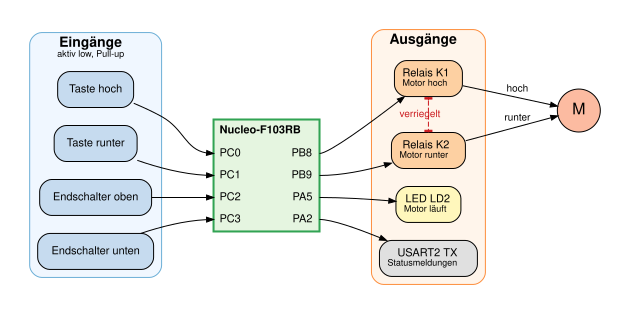
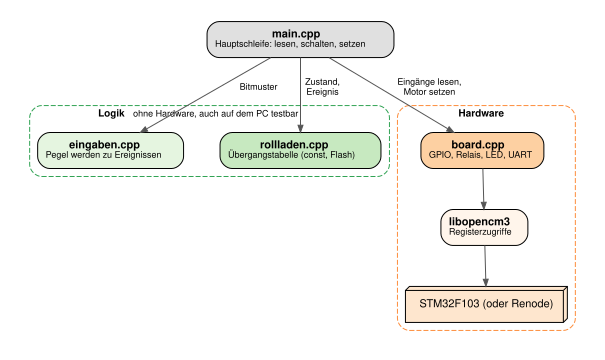
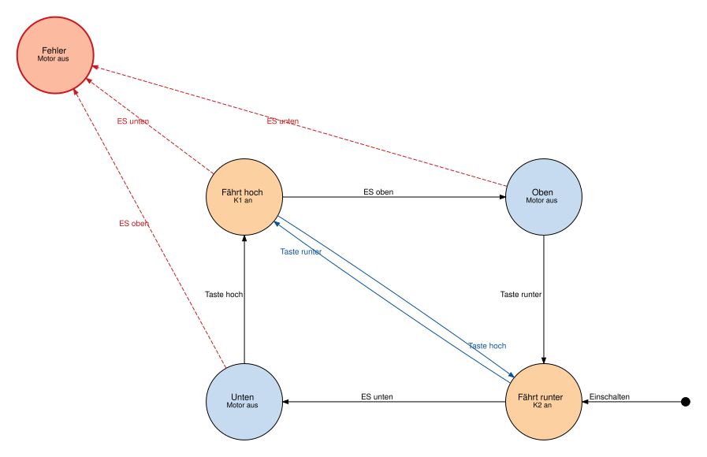
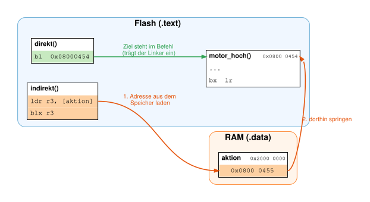
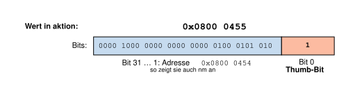
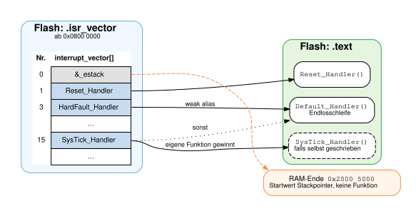
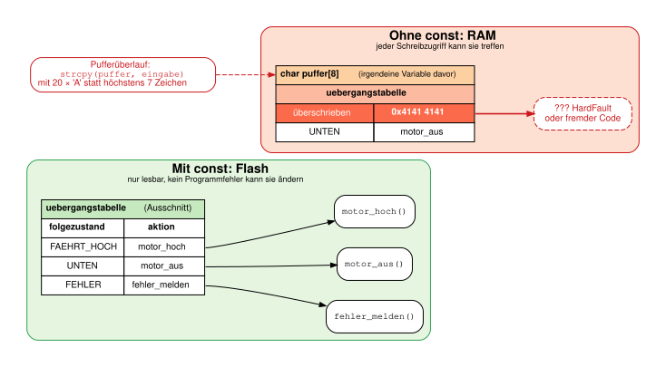

# Übungsaufgabe 001: Rollladensteuerung mit Zustandsautomat

> **Worum geht es?**
> Sie erweitern eine kleine Rollladensteuerung auf dem STM32F103. Der
> Zustandsautomat steht als **Übergangstabelle im Flash** (`.rodata`).
> Ob Ihre Steuerung richtig arbeitet, prüfen automatische Tests, ganz ohne
> Hardware im Emulator Renode.

## Notwendige git-Kommandos

```sh
git fetch --all
# neuen lokalen Branch auf Basis der Aufgabe anlegen
git switch -c solution-001 upstream/exercise-001
# ... Änderungen ...
git add excercise-001
git commit -m "feat: solve exercise-001 roller shutter state machine"
git push -u origin solution-001
```

## Die Anlage

Stellen Sie sich einen Rollladen mit Elektromotor vor. Die Steuerung hat
zwei Taster und zwei Endschalter. Der Motor wird über zwei Relais
geschaltet, eines je Drehrichtung, wie bei einer Wendeschützschaltung.

> **Wendeschützschaltung:** So lässt man einen Motor in beide Richtungen
> laufen. Ein Schütz (ein Schalter für große Ströme) schaltet den Motor für
> die eine Richtung, ein zweites für die andere. Ziehen beide gleichzeitig
> an, gibt es einen Kurzschluss. Deshalb sind die beiden gegeneinander
> **verriegelt**: In der Anlage elektrisch über Hilfskontakte, in unserer
> Firmware zusätzlich in Software (`board_motor_setzen()`).



Die Relais gibt es nur gedanklich. In Renode erscheinen sie als LEDs: an =
Relais zieht an.

## Der Code

Die Firmware ist auf kleine Dateien verteilt. Jede hat genau eine Aufgabe:

| Datei | Aufgabe |
|---|---|
| `src/main.cpp` | Hauptschleife: Eingänge lesen, Automat weiterschalten, Ausgänge setzen |
| `src/rollladen.h/.cpp` | Der Zustandsautomat: Übergangstabelle, Motor je Zustand. **Keine Hardware.** |
| `src/eingaben.h/.cpp` | Flankenerkennung: aus „Taste ist gedrückt“ wird „Taste wurde gerade gedrückt“ |
| `src/board.h/.cpp` | Alles mit Hardware: GPIO, Relais, LED, UART (libopencm3) |
| `renode/rollladen.repl` | Beschreibt für Renode, wo Taster, Endschalter und Relais angeschlossen sind |
| `renode/rollladen.resc` | Startet die Simulation zum Ausprobieren |
| `tests/rollladen.robot` | Automatischer Abnahmetest mit Robot Framework |
| `cmake/check_rodata.cmake` | Prüft mit `nm`, dass die Übergangstabelle im Flash liegt |
| `img/` | Die Grafiken dieser Anleitung als Graphviz-Quellen (`*.dot`), neu erzeugen mit `bash excercise-001/img/erzeugen.sh` |



Die Logik (`eingaben.cpp`, `rollladen.cpp`) kennt keine Hardware. Sie ließe
sich unverändert auf dem PC testen. Nur `board.cpp` weiß, an welchem Pin was
hängt.

Der Automat entspricht dem aus der Vorlesung und den alten Klausuren:



Gestrichelte rote Pfeile: Ein Endschalter meldet etwas, das nicht zur Lage
passt. Dann geht die Steuerung in den Fehlerzustand.

Der **Fehlerzustand** ist eine Plausibilitätsprüfung, wie man sie aus der
Automatisierung kennt. Meldet ein Endschalter etwas, das physikalisch nicht
sein kann, ist vermutlich ein Kabel gebrochen oder ein Schalter verklemmt.
Weiterfahren wäre gefährlich.

## Bauen und testen

```sh
cmake --preset debug
cmake --build --preset debug --target rollladen
ctest --test-dir build/debug --output-on-failure
```

Der CTest `rollladen_tabelle_in_rodata` prüft, dass die Übergangstabelle im
Flash liegt und nicht im RAM.

## Ausprobieren in Renode

Aus dem Hauptverzeichnis des Repositorys:

```sh
renode --disable-xwt --console excercise-001/renode/rollladen.resc
```

Im Renode-Monitor `start` eingeben. Die Meldungen der Firmware erscheinen
über USART2. Taster drücken und loslassen Sie mit:

```text
sysbus.gpioPortC.endschalterUnten Press
sysbus.gpioPortC.tasteHoch Press
sysbus.gpioPortC.tasteHoch Release
sysbus.gpioPortC.endschalterUnten Release
sysbus.gpioPortB.relaisHoch State
```

> **Achtung:** `PressAndRelease` drückt und lässt im selben Augenblick los.
> Die Firmware fragt die Eingänge zyklisch ab (Polling, wie eine SPS) und
> sieht den Tastendruck dann nicht. Nutzen Sie `Press` und `Release`
> getrennt.

## Robot-Framework-Tests (optional, von Hand)

Robot Framework ist noch nicht im Dev-Container installiert. Wer die
Abnahmetests laufen lassen möchte, installiert es einmalig in einer
virtuellen Python-Umgebung:

```sh
python3 -m venv ~/.venv/robot
source ~/.venv/robot/bin/activate
pip install -r /opt/renode/tests/requirements.txt
```

Danach (nach dem Debug-Build, aus dem Hauptverzeichnis):

```sh
source ~/.venv/robot/bin/activate
/opt/renode/renode-test excercise-001/tests/rollladen.robot
```

Ein Testfall liest sich wie eine Prüfanweisung bei der Inbetriebnahme einer
Anlage:

```robot
Faehrt Hoch Und Haelt Oben
    Bis Nach Unten Fahren
    Betaetigen                  ${TASTE_HOCH}  Faehrt hoch
    Motor Sollte Sein           hoch=true  runter=false
    Betaetigen                  ${ES_OBEN}  Oben
    Motor Sollte Sein           hoch=false  runter=false
```

Alternativ laufen die Tests auch über CTest:

```sh
cmake --preset debug -DROLLLADEN_ROBOT_TESTS=ON
cmake --build --preset debug --target rollladen
ctest --test-dir build/debug --output-on-failure
```

## Hintergrund: Funktionszeiger

Für Teil 3 brauchen Sie Funktionszeiger. Hier das Wichtigste dazu, am
Beispiel des STM32.

### Was ist ein Funktionszeiger?

Eine Funktion ist Maschinencode, der an einer bestimmten Adresse im Flash
liegt. Ein **Funktionszeiger** ist eine Variable, die genau diese Adresse
speichert. Über ihn lässt sich die Funktion aufrufen, ohne dass beim
Schreiben des Codes feststeht, *welche* Funktion es ist.

Ein Vergleich aus dem Alltag: Sie können jemanden anrufen, dessen Nummer Sie
auswendig kennen (direkter Aufruf). Oder Sie wählen die Nummer, die auf einem
Zettel steht. Wer den Zettel beschreibt, bestimmt, wer abnimmt (Aufruf über
einen Zeiger). Daher kommt auch der englische Begriff **Callback**, also
„Rückruf“: Man hinterlässt seine Nummer, und jemand anderes ruft später an.

```cpp
void motor_hoch();                // eine ganz normale Funktion

typedef void (*aktion_t)();       // Typ: Zeiger auf Funktion ohne Parameter
                                  //      und ohne Rückgabewert

aktion_t aktion = motor_hoch;     // Adresse merken (ohne Klammern!)
aktion();                         // Aufruf über den Zeiger
```

Die Schreibweise `void (*aktion_t)()` liest man von innen nach außen:
`aktion_t` ist ein **Zeiger** (`*`) auf eine **Funktion** (`()`), die
**nichts** (`void`) zurückgibt. Die Klammern um `*aktion_t` sind Pflicht.
Mit `typedef` muss man das nur einmal schreiben.

### Was passiert im Prozessor?

Beim direkten Aufruf steht die Zieladresse fest im Befehl. Beim Aufruf über
einen Zeiger muss der Prozessor sie erst aus dem Speicher laden:



Die Befehle stammen aus `arm-none-eabi-gcc -O1`. Sie können das selbst
nachprüfen:

```sh
arm-none-eabi-objdump -d build/debug/excercise-001/rollladen | less
```

Für die Pipeline des Prozessors heißt das: Beim indirekten Sprung steht das
Ziel erst fest, wenn die Adresse geladen ist. Der Cortex-M3 leert bei jedem
Sprung ohnehin seine Pipeline. Große Prozessoren mit Sprungvorhersage müssen
dagegen raten, *wohin* der Sprung geht.

### Das Thumb-Bit: Funktionszeiger sind ungerade

Lassen Sie sich die Adresse von `motor_hoch` mit `nm` anzeigen. Sie ist
gerade, z. B. `0x0800 0000`. Im Funktionszeiger steht aber `0x0800 0001`:



Der Cortex-M3 kennt nur den kompakten **Thumb**-Befehlssatz. Bit 0 der
Sprungadresse muss deshalb immer 1 sein. Der Compiler setzt es automatisch.
Wer eine Adresse von Hand in einen Funktionszeiger schreibt und das Bit
vergisst, löst beim Sprung einen Fehler aus (UsageFault, der ohne eigene
Behandlung zum HardFault wird).

### Kennen Sie schon: die Vektortabelle

Sie haben Funktionszeiger schon benutzt, ohne es zu merken. Die Vektortabelle
`interrupt_vector` in `src/startup_stm32f103rb.c` ist eine Tabelle von
Adressen. Bei einem Interrupt holt der Prozessor die Adresse aus dem passenden
Eintrag und springt dorthin.



Alle Handler sind als `weak` mit `alias("Default_Handler")` angelegt. Schreiben
Sie eine eigene Funktion `SysTick_Handler`, gewinnt diese. Vertippen Sie sich
im Namen, landet der Interrupt kommentarlos im `Default_Handler`.

### Zwei Gefahren

**Ein NULL-Zeiger.** Ein Aufruf über einen Zeiger mit dem Wert 0 springt zur
Adresse 0. Dort liegt beim STM32 keine Funktion, sondern ein Abbild der
Vektortabelle, und Bit 0 fehlt. Das Ergebnis ist ein HardFault. Prüfen Sie
Funktionszeiger, die leer sein dürfen, deshalb vor dem Aufruf:

```cpp
if (aktion != nullptr) {
    aktion();
}
```

**Eine Tabelle im RAM.** Liegt eine Tabelle mit Funktionszeigern im RAM, kann
jeder fehlerhafte Schreibzugriff sie treffen, z. B. ein Pufferüberlauf in
einer Variablen davor. Beim nächsten Aufruf springt der Prozessor dann an eine
zufällige Adresse. Mit `const` liegt die Tabelle im Flash und ist vor solchen
Fehlern sicher:



## Aufgaben

### Teil 1: Verstehen

1. Bauen Sie die Firmware und starten Sie sie in Renode. Spielen Sie einen
   kompletten Ablauf durch: einschalten, unten ankommen, hochfahren, oben
   ankommen.
2. Zeichnen Sie den Zustandsautomaten aus `uebergangstabelle` in
   `src/rollladen.cpp` als Diagramm. Welche Einträge der Tabelle bedeuten
   „Ereignis wird ignoriert“?
3. Warum fährt der Rollladen nach dem Einschalten zuerst nach unten?
4. Warum führt „Endschalter oben“ im Zustand „Fährt runter“ *nicht* in den
   Fehlerzustand? Denken Sie an das Einschalten.

### Teil 2: Speicher

1. Wo liegt die Übergangstabelle? Prüfen Sie es selbst:
   ```sh
   arm-none-eabi-nm -C build/debug/excercise-001/rollladen | grep uebergang
   ```
2. Entfernen Sie das `const` vor `uebergangstabelle` und bauen Sie neu.
   Was meldet `nm` jetzt? Wie ändert sich die RAM-Belegung, die der Linker am
   Ende ausgibt? Was sagt der CTest? Erklären Sie das Ergebnis.
3. `gemeldet` in `src/eingaben.cpp` ist `static`. In welchem Segment liegt
   es, und warum?

### Teil 3: Erweitern

1. **Stopp-Taste:** Erweitern Sie die Steuerung um eine dritte Taste
   „Stopp“ an PC4. Sie hält den Rollladen in jeder Bewegung an. Ein neuer
   Zustand „Steht“ ist nötig. Ergänzen Sie dafür:
   - `enum Zustand` und `enum Ereignis` in `src/rollladen.h`,
   - die Übergangstabelle und die Tabellen für Motor und Namen,
   - den Eingang in `src/board.cpp` (Pin und Maske),
   - den Taster in `renode/rollladen.repl`.
2. **Test:** Schreiben Sie einen Robot-Testfall „Haelt Bei Stopp An“.
3. **Totzeit beim Richtungswechsel:** Ein echter Motor darf nicht direkt
   von hoch auf runter umgeschaltet werden. Beide Relais sollen erst für
   eine kurze Pause aus sein. Überlegen Sie: Gehört das in den Automaten
   (`rollladen.cpp`) oder in die Hardwareschicht (`board.cpp`)? Begründen
   Sie Ihre Entscheidung.

4. **Funktionszeiger (für Fortgeschrittene):** Statt nur den Folgezustand
   kann jede Zelle der Tabelle zusätzlich einen Zeiger auf eine Funktion
   enthalten, die beim Übergang ausgeführt wird:
   ```cpp
   struct Uebergang {
       Zustand folgezustand;
       void (*aktion)();   // z. B. motor_hoch, motor_aus, fehler_melden
   };
   ```
   Bauen Sie die Tabelle so um (siehe [Hintergrund: Funktionszeiger](#hintergrund-funktionszeiger)).
   Prüfen Sie danach mit `nm`, wo die Tabelle liegt, einmal mit und einmal
   ohne `const`. Stimmt der Wert im Zeiger mit der Adresse aus `nm` überein?
5. **NULL ausprobieren:** Tragen Sie in einer Zelle `nullptr` als Aktion ein
   und lösen Sie den Übergang in Renode aus. Wo bleibt der Prozessor stehen?
   Finden Sie es mit GDB heraus (`bt`, `info registers pc`).

> **Tipp:** Die Übergangstabelle muss nach jeder Erweiterung vollständig
> sein: eine Zeile je Zustand, eine Spalte je Ereignis. Fehlt ein Eintrag,
> setzt der Compiler dort 0 ein, also `ZUSTAND_FAEHRT_RUNTER`.
